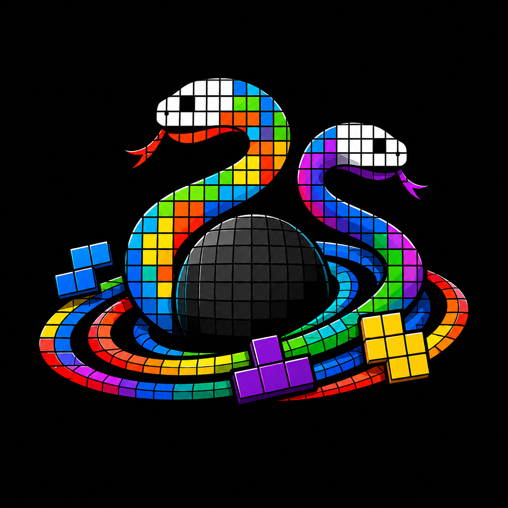
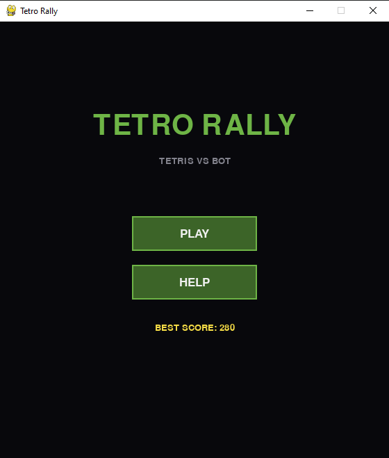
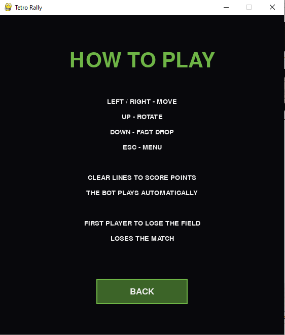
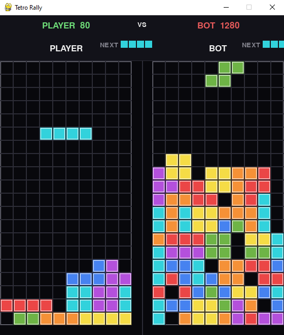
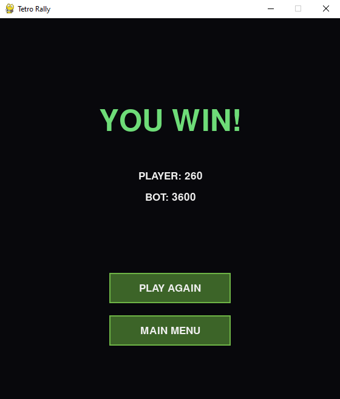
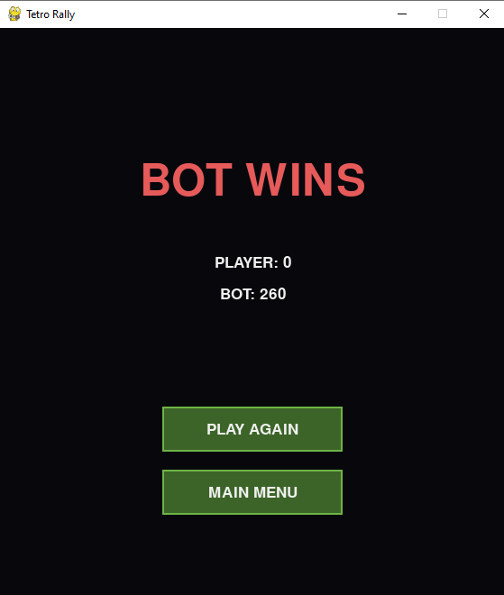

# Tetro Rally

> Competitive Tetris against a computer-controlled opponent.

| Project Information | Details |
|---|---|
| Project ID | NS-014 |
| Direction | Games |
| Development Phase | Phase II |
| Version | v1.0.0 |
| Platform | Windows / Python |
| Status | Completed |

> 

## 📖 Overview

A falling-block puzzle game with two simultaneous boards. The opponent selects moves using a heuristic that evaluates board height, holes, bumpiness and cleared lines.

## ✨ Features

- Player versus computer gameplay

- Independent boards and score tracking

- Heuristic-based opponent

- Piece rotation and next-piece previews

- Persistent best score

## 🛠 Technology Stack

- Python
- Pygame
- JSON

## 📦 Installation

- Download the Windows executable from Releases: [more...](https://github.com/NebulaStack-prog/Tetro-Rally/releases/tag/v1.0.0)

- Or run with Python original source code: [more...](TetroRally.py)

## 📄 Documentation

- Russian documentation: [more...](TR_RU.md)

- English documentation: [more...](TR_EN.md)

## 📊 Project Status

A completed NESTIMS Phase II project. CI checks the original board and opponent logic without entering the graphical event loop.

## 📷 Screenshots

© NESTIMS
